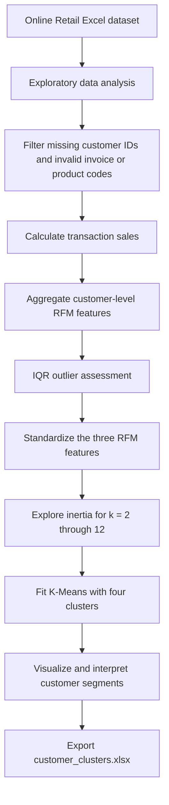
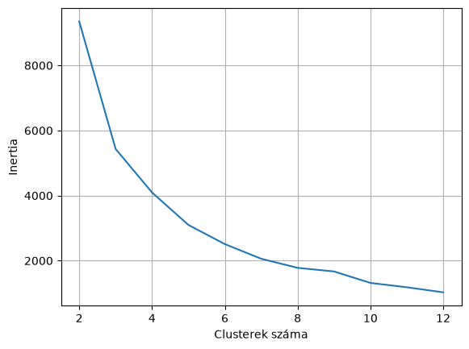
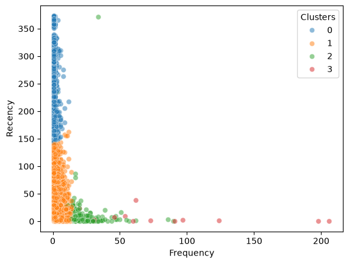
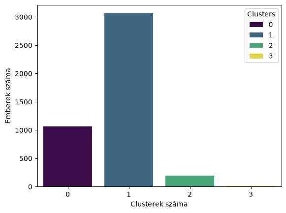
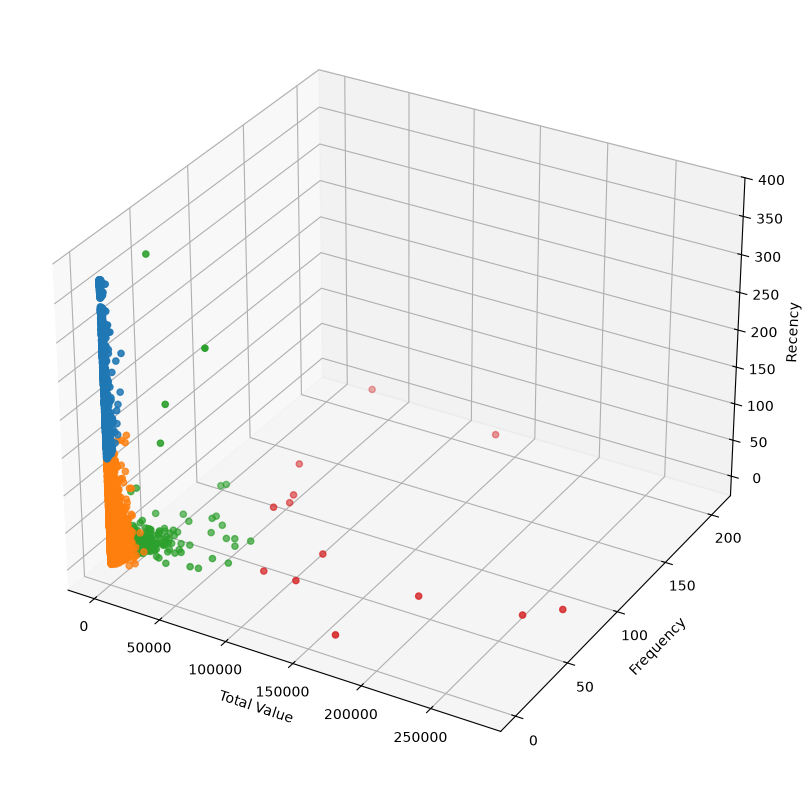

# Customer Segmentation with RFM Analysis and K-Means

An exploratory machine learning project that transforms online retail transactions into customer segments using **Recency, Frequency, and Monetary value (RFM)**. The analysis combines data quality assessment, customer-level feature engineering, feature standardization, and unsupervised clustering to characterize purchasing behavior and support customer relationship management.

The implementation is available in [ClusteringProject_CV.ipynb](data/ClusteringProject_CV.ipynb), with customer assignments exported to [customer_clusters.xlsx](data/customer_clusters.xlsx).

| Project characteristic | Implementation |
| --- | --- |
| Analytical task | Unsupervised customer segmentation |
| Input | 541,909 transaction records across 8 columns |
| Observation period | December 1, 2010–December 9, 2011 |
| Retained transactions | 396,370 records after customer, invoice, and product-code filtering |
| Customer feature matrix | 4,335 customers × 3 RFM features |
| Preprocessing | Z-score standardization with `StandardScaler` |
| Clustering algorithm | K-Means with `n_clusters=4` and `random_state=42` |
| Deliverable | Customer-level Excel table with segment labels |

*Figures and record counts describe the notebook's saved execution outputs. See [Limitations and Future Work](#limitations-and-future-work) for implementation considerations.*

## Contents

- [Project Objectives](#project-objectives)
- [Analytical Workflow](#analytical-workflow)
- [Dataset Overview](#dataset-overview)
- [Exploratory Data Analysis](#exploratory-data-analysis)
- [Data Cleaning](#data-cleaning)
- [Feature Engineering](#feature-engineering)
- [Outlier Assessment](#outlier-assessment)
- [Preprocessing and Clustering Model](#preprocessing-and-clustering-model)
- [Results and Segment Interpretation](#results-and-segment-interpretation)
- [Visual Analysis](#visual-analysis)
- [Repository Structure](#repository-structure)
- [Getting Started](#getting-started)
- [Output Schema](#output-schema)
- [Limitations and Future Work](#limitations-and-future-work)
- [License](#license)

## Project Objectives

- Convert transaction-level records into interpretable customer purchasing profiles.
- Identify behavioral groups based on spending, purchase frequency, and time since the most recent purchase.
- Explore cluster structure through inertia diagnostics and multidimensional visualizations.
- Produce a customer segmentation table for further profiling and potential retention or loyalty initiatives.

## Analytical Workflow



The current outlier-filtering expression retains all 4,335 customers; the clustering results therefore include extreme customer profiles.

## Dataset Overview

The bundled [Online Retail.xlsx](data/Online%20Retail.xlsx) workbook contains invoice-line records. Each row represents a product line within an invoice, so transaction rows and distinct purchases are different units of analysis.

| Column | Description | Analytical role |
| --- | --- | --- |
| `InvoiceNo` | Invoice identifier | Invoice validation and distinct purchase counts |
| `StockCode` | Product identifier | Product-code filtering |
| `Description` | Product description | Exploratory inspection |
| `Quantity` | Number of units on an invoice line | Transaction sales calculation |
| `InvoiceDate` | Invoice timestamp | Customer recency calculation |
| `UnitPrice` | Price per unit | Transaction sales calculation |
| `CustomerID` | Customer identifier | Customer-level aggregation |
| `Country` | Customer country | Descriptive context; excluded from clustering |

Only the three engineered RFM variables enter the model. Customer identifiers, product descriptions, and geography are excluded from the clustering feature space.

## Exploratory Data Analysis

The notebook uses `head()`, `info()`, `describe()`, and missing-value counts to examine schema, distributions, and data quality. It also inspects negative quantities, negative prices, and nonstandard identifier formats.

The saved outputs identify:

- **135,080 missing customer identifiers** and **1,454 missing product descriptions**.
- **10,624 records with negative quantities**.
- **Two records with negative unit prices**, described as bad-debt adjustments.
- Invoice identifiers containing `C` or `A` prefixes and product codes outside the accepted merchandise patterns.

These checks motivate filtering before customer-level aggregation.

## Data Cleaning

The implemented cleaning sequence:

1. Removes rows without a `CustomerID`.
2. Converts invoice identifiers to strings and retains only six-digit values matching `\d{6}`. This excludes prefixed cancellation and adjustment invoices.
3. Retains product codes consisting of five digits, optionally followed by one or more alphabetic characters: `^\d{5}$` or `^\d{5}[a-zA-Z]+$`.
4. Checks the retained records for negative quantities and missing values.

After these filters, the saved notebook contains **396,370 transaction rows**, with no missing values and no negative quantities in the inspected output. The notebook does not apply a separate positive-price filter or explicit duplicate removal.

## Feature Engineering

Transaction sales are calculated as:

```text
TotalSales = Quantity × UnitPrice
```

Transactions are then aggregated by `CustomerID` to construct the RFM feature matrix:

| Feature | Calculation | Behavioral interpretation |
| --- | --- | --- |
| `Recency` | Whole days between the latest retained invoice timestamp in the dataset and the customer's latest invoice | Lower values indicate more recent purchasing activity |
| `Frequency` | Number of distinct retained `InvoiceNo` values per customer | Higher values indicate more purchase occasions |
| `TotalValue` | Sum of `TotalSales` per customer | Monetary value of retained purchases during the observation period |

`LastInvoiceDate` is retained for interpretation and export. The recency reference is the maximum retained invoice timestamp, rather than the current date; customers purchasing at that timestamp have a recency of zero.

The aggregation produces **4,335 customer profiles**. Because cancellation invoices are excluded, `TotalValue` describes retained purchase value rather than revenue net of returns.

## Outlier Assessment

The notebook calculates the first quartile, third quartile, and interquartile range for `TotalValue` and `Frequency`. Candidate outliers fall outside the conventional Tukey fences:

```text
IQR = Q3 − Q1
Lower fence = Q1 − 1.5 × IQR
Upper fence = Q3 + 1.5 × IQR
```

**Current implementation:** the exclusion expression passes DataFrames to `Index.isin()` instead of their row indices. As a result, the saved `non_outliers_df` still contains all 4,335 customers. Outlier detection is present, but the displayed model results do not reflect effective outlier removal.

## Preprocessing and Clustering Model

### Feature Standardization

`StandardScaler` transforms `TotalValue`, `Frequency`, and `Recency` to z-scores:

```text
z = (x − feature mean) / feature standard deviation
```

This places the features on comparable scales before distance-based clustering. The notebook applies scaling directly to the RFM variables without a logarithmic transformation.

### Cluster-Count Exploration

K-Means is fitted for **k = 2 through 12**, and inertia is plotted to explore the trade-off between model complexity and within-cluster compactness. Inertia is the sum of squared distances between observations and their assigned centroids.

The final implementation uses **four clusters**. The elbow curve provides an exploratory diagnostic; the notebook does not report additional quantitative validation establishing four as the optimal cluster count.

### Final Model

```python
kmeans = KMeans(n_clusters=4, random_state=42)
prediction = kmeans.fit_predict(scaled_data)
```

The model partitions customers in the standardized, three-dimensional RFM feature space. Cluster assignments are appended to the customer table and subsequently mapped to descriptive labels. Other K-Means parameters, including `n_init`, use the installed scikit-learn version's defaults.

## Results and Segment Interpretation

The saved execution assigns all **4,335 customers** to four segments. The following descriptions summarize the notebook's qualitative interpretation and visual patterns; they are not calculated centroid statistics.

| Cluster | Exported label | Qualitative profile | Potential analytical use |
| --- | --- | --- | --- |
| 0 | `Leave` | Long time since the last purchase; comparatively limited purchasing activity | Investigate inactive customers and reactivation opportunities |
| 1 | `Soon leave` | Broad customer group with generally lower spending and frequency than the high-activity segments; more recent activity than cluster 0 | Examine repeat-purchase behavior before defining retention interventions |
| 2 | `Loyal` | Generally higher spending and purchase frequency, with predominantly recent activity and some exceptions | Explore loyalty engagement and cross-selling hypotheses |
| 3 | `Very Loyal` | Small group of exceptionally high-value and/or frequent purchasers, generally with recent activity | Review high-value relationships and potential account-management needs |

The exported names reproduce the notebook's mapping. **`Leave` and `Soon leave` are heuristic segment names, not validated churn predictions.** No churn target or supervised prediction model is used, and cluster numbers have no intrinsic ordinal meaning.

## Visual Analysis

The figures below are extracted from the notebook's saved outputs.

### Inertia Across Candidate Cluster Counts



The curve shows how within-cluster dispersion decreases as the number of clusters increases. The horizontal label, “Clusterek száma,” means “Number of clusters.”

### Purchase Frequency and Recency



This projection highlights the separation between customers with long purchase gaps and customers with more recent, frequent activity. `TotalValue`, the third model feature, is not represented on these axes.

### Segment Distribution



The segmentation is imbalanced: cluster 1 contains the largest customer group, while cluster 3 is very small. “Emberek száma” means “Number of people”; the bars represent customer counts. This chart uses a different color palette from the scatter plots, so compare segments by cluster ID.

### Three-Dimensional RFM View



The plot displays the original RFM units for interpretation, although clustering is performed on standardized features. Extreme spending and frequency values remain visible because the current outlier filter retains them.

## Repository Structure

```text
ClusteringProject/
├── README.md
├── LICENSE
├── data/
│   ├── ClusteringProject_CV.ipynb   # Analysis and clustering workflow
│   ├── Online Retail.xlsx         # Transaction-level input workbook
│   ├── customer_clusters.xlsx     # Customer segmentation export
│   └── placeholde                # Existing placeholder file
└── docs/
    └── images/                   # Notebook figures used in this README
        ├── elbow-curve.png
        ├── frequency-recency.png
        ├── cluster-distribution.png
        └── rfm-clusters-3d.png
```

## Getting Started

### 1. Clone the Repository

```bash
git clone https://github.com/lazarknausz/ClusteringProject.git
cd ClusteringProject
python -m venv .venv
```

Activate the environment using the command for your shell:

```powershell
# Windows PowerShell
.\.venv\Scripts\Activate.ps1
```

```bash
# macOS / Linux
source .venv/bin/activate
```

### 2. Install Dependencies

```bash
python -m pip install pandas numpy scikit-learn matplotlib seaborn openpyxl jupyterlab ipykernel
```

The project uses pandas and NumPy for data preparation, scikit-learn for preprocessing and clustering, Matplotlib and Seaborn for visualization, and openpyxl for Excel input/output. A dependency lockfile is not currently included.

### 3. Align the Input Filename

The notebook currently loads `online_retail.xlsx`, whereas the committed workbook is named `Online Retail.xlsx`. Before running the notebook, update the loading statement to match the bundled filename:

```python
df = pd.read_excel("Online Retail.xlsx")
```

### 4. Execute the Notebook

Launch JupyterLab from the `data` directory so relative input and output paths resolve correctly:

```bash
cd data
python -m jupyterlab ClusteringProject_CV.ipynb
```

Select the environment's Python kernel and run the cells from top to bottom. The final cell writes `customer_clusters.xlsx` to the notebook's working directory, replacing the existing file of the same name. The filename change above is a setup instruction; the committed notebook retains its original code.

## Output Schema

The final Excel export contains one row per customer:

| Column | Content |
| --- | --- |
| `CustomerID` | Customer identifier |
| `TotalValue` | Aggregated value of retained purchases |
| `Frequency` | Distinct retained invoice count |
| `LastInvoiceDate` | Latest retained invoice timestamp for the customer |
| `Recency` | Whole days since that timestamp, relative to the dataset reference |
| `Clusters` | One of `Leave`, `Soon leave`, `Loyal`, or `Very Loyal` |

The notebook exports customer assignments; it does not persist a fitted model or scaler for scoring new customers.

## Limitations and Future Work

- **Correct the outlier exclusion.** Use the detected outlier row indices when constructing the exclusion mask, then refit and reassess the segments. High-value customers may also warrant separate profiling instead of automatic removal.
- **Strengthen cluster validation.** Add silhouette and Davies–Bouldin scores, compare candidate cluster counts, and assess stability across random seeds and time periods.
- **Quantify segment profiles.** Report per-cluster customer counts, RFM means and medians, and spending shares before assigning business labels.
- **Evaluate distributional assumptions.** Compare raw standardized features with suitable transformations for skewed spending and frequency distributions.
- **Expand data quality checks.** Review duplicate records and zero-price transactions, and define an explicit treatment of returns and cancellations.
- **Validate business relevance.** Test retention and loyalty hypotheses against subsequent purchasing behavior; the current analysis does not establish churn risk or campaign effectiveness.
- **Improve reproducibility.** Pin dependency versions and set `n_init` explicitly. Preserve the scaler and model if extending the notebook to assign future customers to existing segments.

## License

This repository includes an [MIT License](LICENSE).

